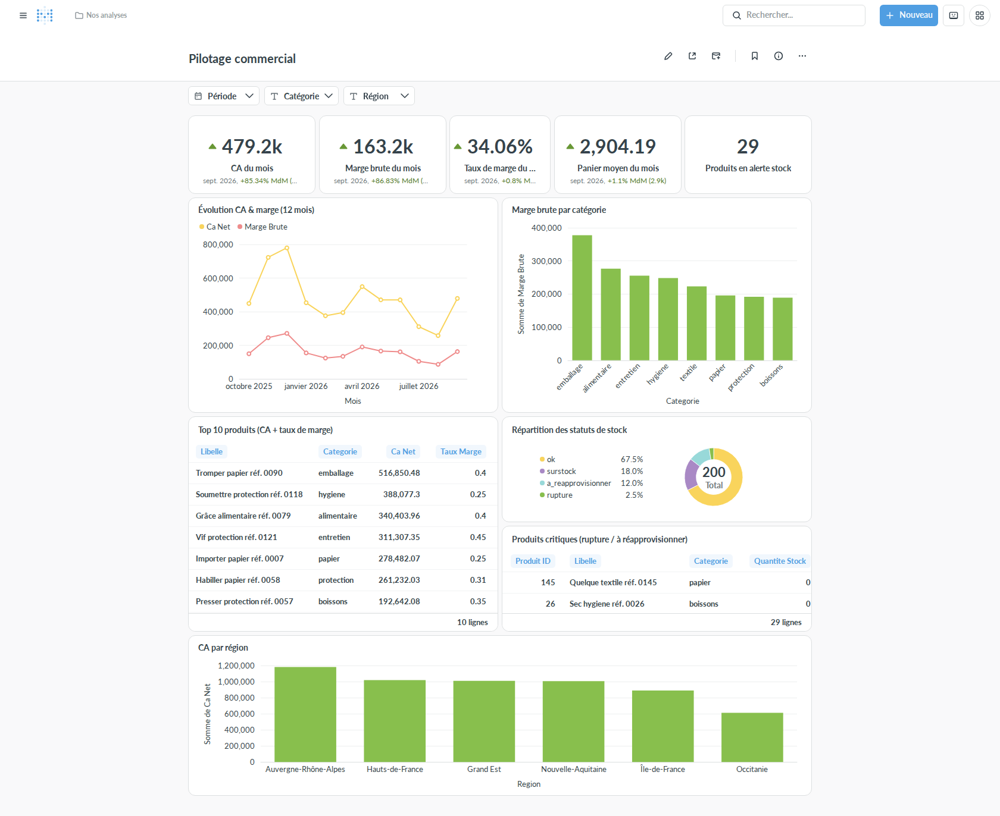
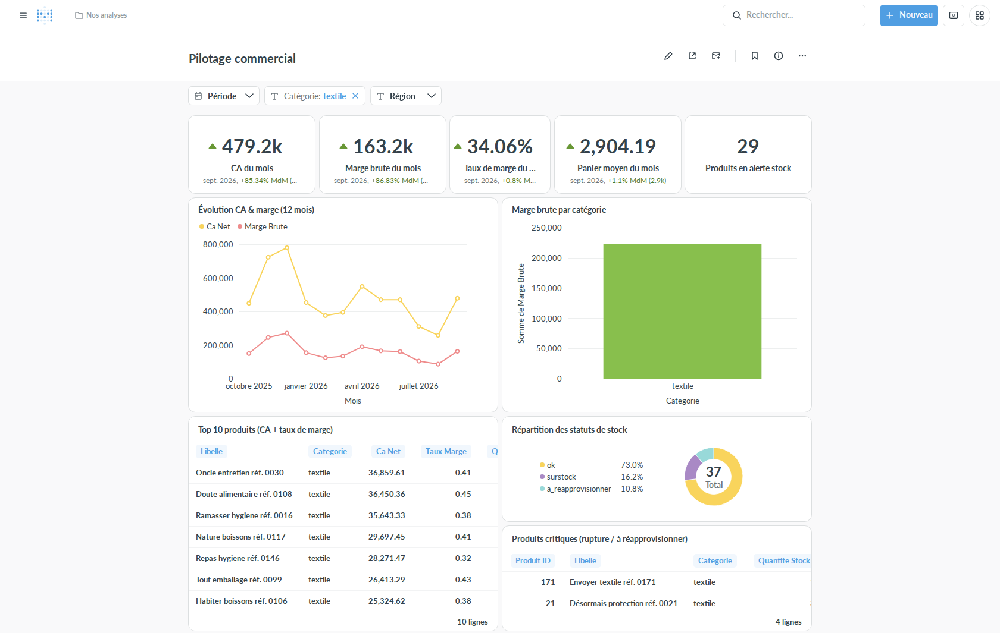
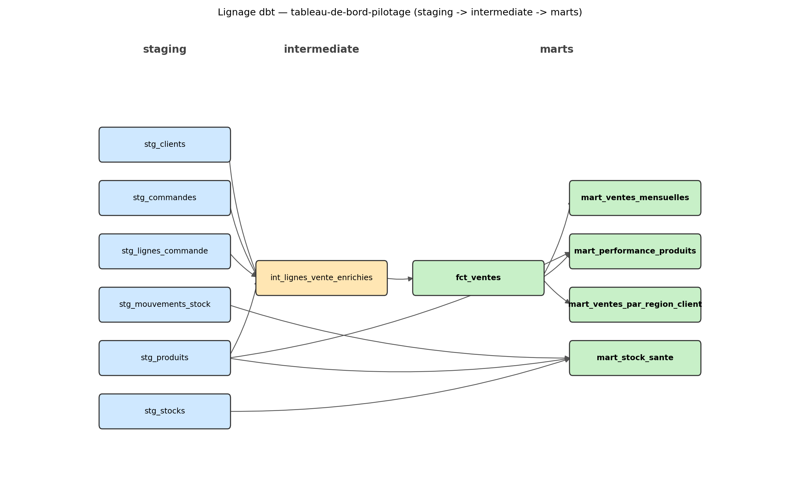

# Tableau de bord de pilotage

> Projet de démonstration (portfolio Malt, profil data engineer / BI).
> **Données 100 % fictives.**

## Le problème

Dans une PME fictive de commerce de gros, le dirigeant passe des heures sur
Excel chaque mois pour savoir où en sont ses ventes, ses marges et ses
stocks.

## La solution

Les données sont modélisées et calculées de façon fiable avec dbt
(staging → marts, testées et documentées), puis affichées dans un tableau
de bord Metabase pensé pour répondre à « est-ce que ça va bien ? » en 30
secondes.

**Temps gagné (hypothèse de scénario, pas une mesure réelle)** : si ce
tableau de bord remplaçait la consolidation Excel manuelle évoquée
ci-dessus, le dirigeant gagnerait ce temps de consolidation mensuelle et
verrait les alertes stock/marge en continu plutôt qu'en fin de mois — un
ordre de grandeur pour ce scénario fictif, pas un résultat mesuré sur une
vraie PME.

## Le tableau de bord



4 KPI clés (vs mois précédent), évolution CA & marge, marge par catégorie,
top 10 produits, santé des stocks, CA par région — un seul écran, pas plus
de 6 blocs. Détail du cadrage (questions du dirigeant, maquette) :
[`specs/01-cadrage-kpi-dashboard.md`](specs/01-cadrage-kpi-dashboard.md) et
[`docs/maquette-dashboard.md`](docs/maquette-dashboard.md).

Le dashboard a 3 filtres natifs Metabase (Période, Catégorie, Région),
mappés directement sur les colonnes des marts — aucune requête custom.
Exemple avec le filtre Catégorie actif (« textile ») : les cartes
concernées (marge par catégorie, top 10, stocks) se restreignent, celles
basées sur l'agrégat mensuel toutes catégories confondues restent
inchangées (conséquence du grain des marts, détaillé dans
[`metabase/README.md`](metabase/README.md)) :



## Questions du dirigeant et définitions des KPI

Cadrage complet (y compris les questions auxquelles chaque bloc répond) :
[`specs/01-cadrage-kpi-dashboard.md`](specs/01-cadrage-kpi-dashboard.md).
Définitions reprises telles quelles dans le code dbt (`dbt_project/models/`,
documentées en YAML) :

- **CA net** = Σ (quantité × prix unitaire facturé × (1 − remise)).
- **Marge brute (€)** = CA net − Σ (quantité × prix d'achat).
- **Taux de marge (%)** = marge brute ÷ CA net.
- **Panier moyen** = CA net ÷ nombre de commandes.
- **Couverture de stock (jours)** = quantité en stock ÷ ventes moyennes
  journalières des 30 derniers jours.
- **Statut de stock** : `rupture` (stock = 0), `à réapprovisionner` (stock
  sous le seuil OU couverture < 7 jours), `surstock` (couverture > 90
  jours), `OK` sinon — seuils centralisés dans une macro dbt, jamais
  dupliqués en dur.
- **Variation vs mois précédent** : comparaison du dernier mois complet
  disponible au mois précédent, en valeur et en %.

Vérifié à la main sur le mois de septembre 2026 (requête SQL directe sur
`marts.fct_ventes`, indépendante de Metabase) : CA net 479 190,69 €, marge
brute 163 188,55 €, taux de marge 34,06 % — identique aux chiffres affichés
sur le dashboard. Idem pour les 29 produits en alerte stock
(`marts.mart_stock_sante`, statuts `rupture` + `a_reapprovisionner`).

## Architecture

```
Générateur de données fictives (Python + Faker, graine fixe)
        ↓ (chargement direct, pas de logique métier)
PostgreSQL — schéma raw
        ↓
dbt : staging → intermediate → marts
      (toute la logique métier et tous les KPI, testés et documentés)
        ↓
Metabase — uniquement de la visualisation sur les marts déjà calculés
```

Répartition stricte des responsabilités (détail :
[`specs/00-vision.md`](specs/00-vision.md)) : si un chiffre affiché dans
Metabase n'existe pas déjà comme colonne d'un mart dbt, c'est qu'il manque
une colonne dans un mart — jamais une requête custom côté Metabase.

## Relancer la démo

```bash
cp .env.example .env
docker compose up -d
```

- Metabase : http://localhost:3000
- Postgres : localhost:5433 (identifiants dans `.env`) — port volontairement
  différent du standard 5432 pour pouvoir tourner en parallèle du projet 1
  ([rapport-commercial-auto](https://github.com/emilienmarotta/rapport-commercial-auto))
  sans conflit.

Générer les données fictives (schéma `raw`, 12 mois d'historique,
reproductible à l'identique grâce à une graine fixe) :

```bash
python3 -m venv .venv
.venv/bin/pip install -r generator/requirements.txt
.venv/bin/python generator/generate.py --reset
```

Construire les modèles dbt (`staging` → `intermediate` → `marts`, tous les
KPI calculés ici — rien n'est recalculé côté Metabase) :

```bash
.venv/bin/pip install -r dbt_project/requirements.txt
cp dbt_project/profiles.yml.example dbt_project/profiles.yml
cd dbt_project && ../.venv/bin/dbt build --profiles-dir . && cd ..
```

Construire le dashboard Metabase (connexion DB, questions, filtres — voir
[`metabase/README.md`](metabase/README.md) pour le détail et la limite de
cette approche vs un export natif) :

```bash
.venv/bin/pip install requests
set -a && source .env && set +a
.venv/bin/python metabase/setup_metabase.py
```

## Structure du dépôt

```
tableau-de-bord-pilotage/
├── docker-compose.yml
├── .env.example
├── specs/                   # spécifications (lues avant d'écrire du code)
├── generator/                # génération des données fictives
├── dbt_project/
│   ├── models/
│   │   ├── staging/
│   │   ├── intermediate/
│   │   └── marts/
│   ├── tests/                # tests métier personnalisés
│   └── macros/
├── metabase/                 # script de construction du dashboard + doc
└── docs/                     # captures, maquette, lignage dbt
```

État détaillé de chaque milestone : [`ROADMAP.md`](ROADMAP.md). État de
chaque spec : [`specs/README.md`](specs/README.md).

## Lignage dbt



Généré depuis `dbt_project/target/manifest.json`
(voir [`docs/render_lineage.py`](docs/render_lineage.py) — substitution à
une capture `dbt docs` UI, cf. [`specs/05-dbt-tests-docs.md`](specs/05-dbt-tests-docs.md)
pour le détail de ce choix).

## Limites assumées

- Données entièrement fictives, aucun lien avec une vraie PME.
- Démo locale uniquement (pas d'hébergement), pas d'authentification
  multi-utilisateurs avancée.
- Pas de volumétrie réaliste de grande entreprise, pas de prévisions /
  machine learning : ce projet démontre une démarche BI de bout en bout
  (cadrage → modélisation → visualisation), pas un produit prêt pour la
  production.
- Les 4 cartes du bandeau et « Évolution CA & marge » n'ont pas de filtre
  Catégorie/Région (le mart mensuel qui les alimente est agrégé toutes
  catégories/régions confondues) — conséquence assumée du grain des marts,
  détaillée dans [`metabase/README.md`](metabase/README.md).
